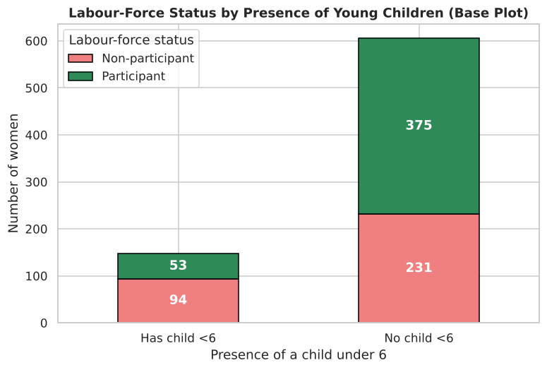
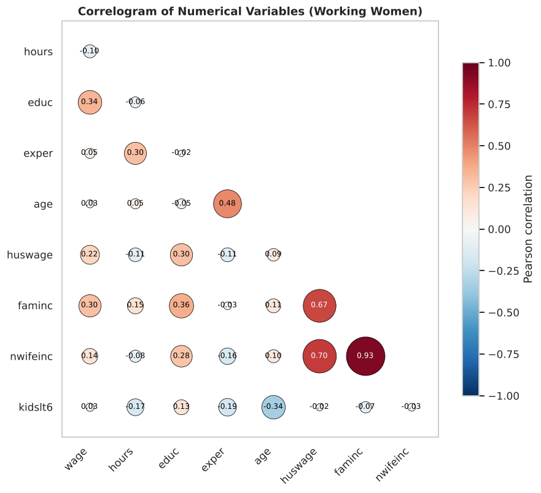
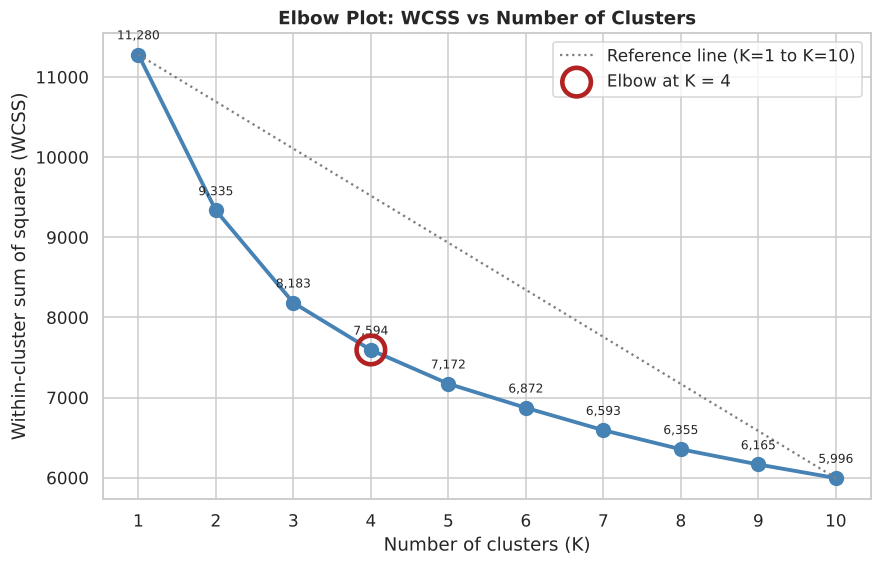
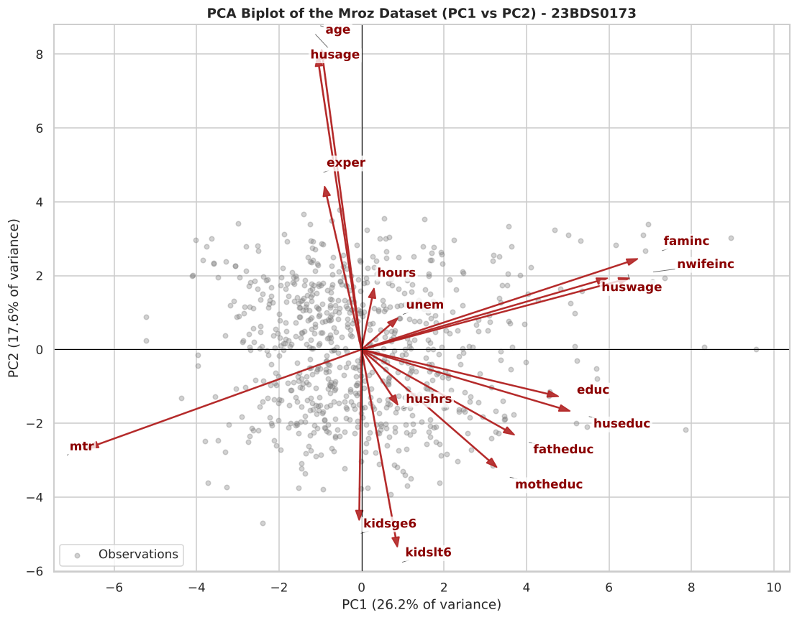

# Exploratory Data Analysis Lab: Assessments 1–9

**BCSE331P – Exploratory Data Analysis (Lab)** · VIT Vellore
**Sai Siddhanth** · Registration No. **23BDS0173**

[](https://colab.research.google.com/github/saisiddhanthks/EDA-Lab-Assessments-23BDS0173/blob/main/notebooks/EDA_Lab_Assessments_1-9.ipynb)
[](https://nbviewer.org/github/saisiddhanthks/EDA-Lab-Assessments-23BDS0173/blob/main/notebooks/EDA_Lab_Assessments_1-9.ipynb)


This repository contains the full lab project for the course. A single Jupyter notebook answers all nine lab assessments, from data merging and cleaning through univariate, bivariate and multivariate analysis to time-series modelling, clustering and principal component analysis. The notebook was executed top to bottom in one run (cells 1–157 in order, no errors). Every output and figure shown is from that run.

> **Project demonstration video (6:58):** [watch in the browser](https://saisiddhanthks.github.io/EDA-Lab-Assessments-23BDS0173/demo.html) · [download the MP4](https://github.com/saisiddhanthks/EDA-Lab-Assessments-23BDS0173/raw/main/video/23BDS0173_Sai_Siddhanth_EDA_Project_Demo.mp4)

---

## Dataset

**Mroz (1987)** – T. A. Mroz, *Econometrica* 55(4). The data come from the 1975 wave of the Panel Study of Income Dynamics (PSID): **753 married women** aged 30–60 and **22 variables** on labour-force participation, hours, wages, education, experience, children and household income. It is the standard dataset for studying women's labour-force participation.

| | |
|---|---|
| Source used by the notebook | `https://raw.githubusercontent.com/salemprakash/EDA/main/Data/mroz.csv` |
| Local copy | [`data/mroz.csv`](data/mroz.csv) |
| Missing values | `wage` and `lwage` are missing for the 325 women who did not work in 1975. This is structural missingness, and the cleaning assessments use it directly. |

<details>
<summary><b>Variable dictionary</b></summary>

| Variable | Meaning | Variable | Meaning |
|---|---|---|---|
| `inlf` | 1 if in the labour force in 1975 | `huseduc` | Husband's years of schooling |
| `hours` | Hours worked by the wife in 1975 | `huswage` | Husband's hourly wage ($) |
| `kidslt6` | Number of children younger than 6 | `faminc` | Family income in 1975 ($) |
| `kidsge6` | Number of children aged 6–18 | `mtr` | Federal marginal tax rate variable |
| `age` | Wife's age | `motheduc` | Mother's years of schooling |
| `educ` | Wife's years of schooling | `fatheduc` | Father's years of schooling |
| `wage` | Wife's hourly wage ($), workers only | `unem` | County unemployment rate (%) |
| `repwage` | Reported wage at the 1976 interview | `city` | 1 if living in an SMSA (urban) |
| `hushrs` | Hours worked by the husband | `exper` | Years of labour-market experience |
| `husage` | Husband's age | `nwifeinc` | Non-wife family income ($000) |
| `lwage` | log(wage), workers only | `expersq` | `exper` squared |

</details>

---

## Contents of the notebook

| # | Assessment | What is covered |
|---|---|---|
| 1 | **Merging and Data Transformation** | Append, concatenate, merge; inner / left / right / full outer joins; min–max scaling to three ranges, z-scores, decimal scaling |
| 2 | **Data Import, Transform and Basic Statistics** | Import, structure, summary statistics, missing-value analysis, mean / median / mode / LOCF / NOCB imputation, duplicates, factors, derived columns, spread measures |
| 3 | **Data Cleaning and Univariate Analysis** | Column dropping, imputation, data-type fixes, box-plot and IQR outlier detection, histograms, density, violin, dot, bar, pie, lollipop charts, `facet_wrap` |
| 4 | **Bivariate Analysis** | Contingency tables, stacked and grouped bars, scatter, line, heatmap, density by group, box and violin plots, correlogram |
| 5 | **Multivariate Analysis** | Colour, shape and size encodings, bubble plot, `facet_wrap` / `facet_grid`, pairs plot, parallel coordinates |
| 6 | **Time Series Analysis** | Series construction, decomposition, ACF / PACF, ADF test, ARIMA selection by AIC, 12-month forecast |
| 7 | **1-D, 2-D and N-D Analysis** | Structured summary tables, frequency and binned tables, row and column percentages, grouped statistics, Pearson and Spearman correlation, N-D plots |
| 8 | **K-Means and Hierarchical Clustering** | Standardisation, K-means, WCSS elbow method, cluster profiling, Euclidean distance, Ward linkage, dendrogram, `cutree` |
| 9 | **Principal Component Analysis** | Scaling, PCA summary, scree plot, biplot with non-overlapping labels, PC scores, PC1 vs PC2 scatter |

The question papers were written for **R**. Each task is implemented with its closest Python equivalent, and the mapping is documented in the notebook (for example `dplyr` → pandas, `ggplot2` → seaborn / `seaborn.objects`, `ggrepel` → adjustText, `prcomp` → `sklearn.decomposition.PCA`). Where a question names a built-in R dataset, such as AirPassengers in Assessment 6, the same workflow is applied to Mroz as instructed.

---

## Key findings

- **Young children reduce participation sharply.** Women with a child under 6 participate at **36%**, compared with **62%** for women without one, a 26-point gap that holds in both rural and urban areas.
- **Education raises participation and wages.** Participation rises from **45%** below high school to **76%** for college graduates (χ² test, p ≈ 0.00002).
- **Family income is driven by the husband's wage.** The Pearson correlation is **r = 0.725**, so the husband's wage alone explains **52.6%** of the variation in family income.
- **Imputation shrinks variability.** Median imputation lowers the SD of `wage` from **3.31 to 2.52**, which is why imputed values must be interpreted with care.
- **The time series is honest about its limits.** Family income on a constructed monthly index is stationary (ADF test) and close to white noise (Ljung–Box test). AIC selects **ARIMA(1, 0, 0)**, and the forecast correctly flattens to the mean (≈ 23.08 thousand).
- **Four household segments.** The elbow method suggests **K = 4**. Ward's hierarchical clustering recovers the same structure.
- **PCA.** Five components have eigenvalues above 1 and together explain about **70%** of the variance. PC1 captures household income and education, and PC2 captures life-cycle stage (age vs young children).

---

## Selected figures

| | |
|:---:|:---:|
|  |  |
| Labour-force status by presence of a child under 6 | Correlogram of numerical variables (working women) |
|  |  |
| Elbow plot (K = 4) | PCA biplot, PC1 vs PC2 |

More figures are in [`figures/`](figures/). All 56 plots are in the notebook.

---

## Repository structure

```
EDA-Lab-Assessments-23BDS0173/
├── notebooks/
│   └── EDA_Lab_Assessments_1-9.ipynb   # complete, executed notebook (Assessments 1–9)
├── report/
│   └── 23BDS0173_EDA_Lab_Report.pdf    # PDF export of the executed notebook
├── data/
│   └── mroz.csv                        # Mroz (1987) dataset, 753 × 23 (incl. row id)
├── figures/                            # key figures exported from the notebook
├── requirements.txt
└── README.md
```

---

## How to run

**Google Colab (recommended).** Click the *Open in Colab* badge above, then choose **Runtime → Run all**. The notebook installs `adjustText` itself and reads the dataset from its public URL, so no setup is needed.

**Locally**

```bash
git clone https://github.com/saisiddhanthks/EDA-Lab-Assessments-23BDS0173.git
cd EDA-Lab-Assessments-23BDS0173
pip install -r requirements.txt
jupyter notebook notebooks/EDA_Lab_Assessments_1-9.ipynb
```

If you are offline, point the notebook's `URL` variable at `data/mroz.csv`.

---

## Tools

`pandas` · `numpy` · `matplotlib` · `seaborn` · `scipy` · `statsmodels` · `scikit-learn` · `adjustText`

---

<sub>Submitted by Sai Siddhanth (23BDS0173), B.Tech CSE (Data Science), VIT Vellore, for academic coursework.</sub>
